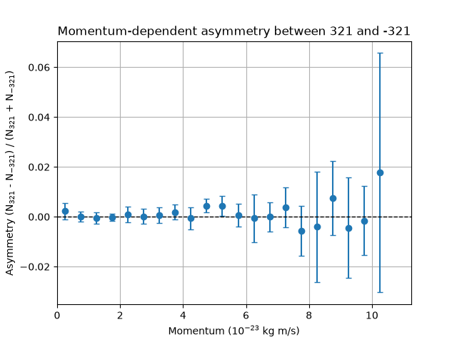
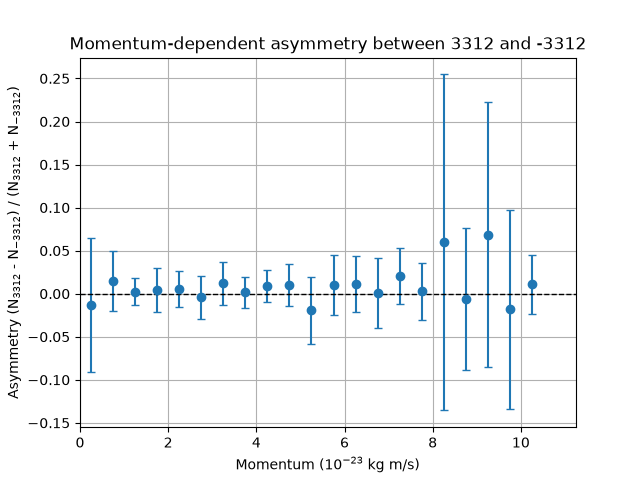
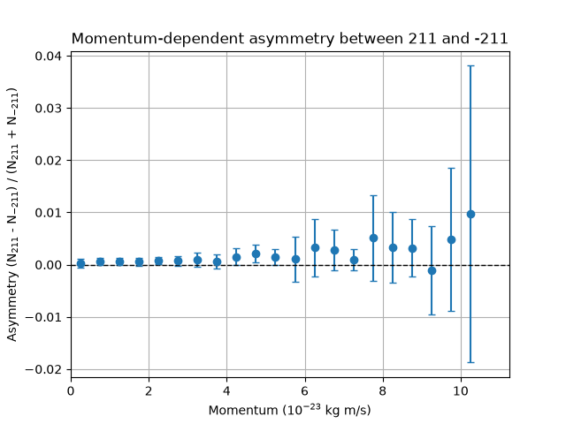
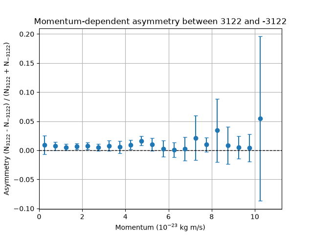
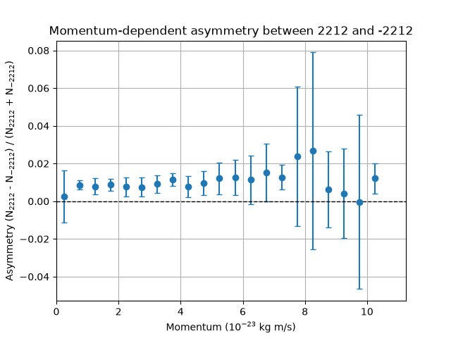
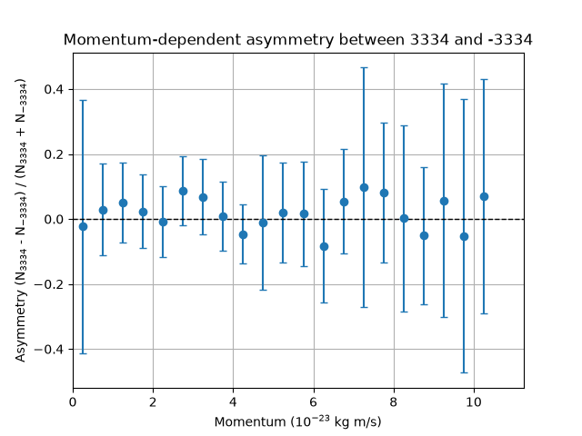

# PRA2003 — Chemistry-Themed Project

**Name:** Cas Coolen  
**Student ID:** i6413130

## Research Questions

1. What are the average counts of each molecular species, and what are their statistical uncertainties?
2. Is there an asymmetry between the normal and variant molecules?
3. Is there an asymmetry as a function of momentum?

---

## Question 1 — Average Counts and Statistical Uncertainties

The values below are the weighted average counts of each molecular species across **5 million events**, split into 10 subsamples. The uncertainty was calculated as the standard deviation of the means across the subsamples.

| Molecular ID | Average Count | Uncertainty |
|---:|---:|---:|
| 3222 | 0.149530 | 0.000606 |
| -3122 | 0.271699 | 0.000935 |
| 211 | 19.949556 | 0.031066 |
| -211 | 19.917257 | 0.030238 |
| 321 | 2.509156 | 0.004529 |
| 2212 | 1.208037 | 0.001799 |
| -2212 | 1.184165 | 0.002288 |
| 310 | 2.477133 | 0.005063 |
| 130 | 2.478431 | 0.005333 |
| 3122 | 0.276602 | 0.001019 |
| -3112 | 0.146948 | 0.000527 |
| 3112 | 0.148963 | 0.000547 |
| -3312 | 0.039004 | 0.000382 |
| -3322 | 0.038954 | 0.000281 |
| -3222 | 0.147801 | 0.000508 |
| 3312 | 0.039443 | 0.000269 |
| -3212 | 0.151375 | 0.000746 |
| 3212 | 0.153098 | 0.000542 |
| 431 | 0.011681 | 0.000122 |
| -431 | 0.011736 | 0.000158 |
| 3322 | 0.039216 | 0.000172 |
| 3334 | 0.001188 | 0.000040 |
| -531 | 0.000954 | 0.000044 |
| -3334 | 0.001154 | 0.000048 |
| 4232 | 0.000591 | 0.000028 |
| -4232 | 0.000588 | 0.000028 |
| 531 | 0.000980 | 0.000056 |
| -4132 | 0.000572 | 0.000026 |
| 4132 | 0.000580 | 0.000034 |
| -5132 | 0.000044 | 0.000009 |
| 5232 | 0.000054 | 0.000012 |
| 5132 | 0.000060 | 0.000016 |
| -5232 | 0.000055 | 0.000011 |
| -4332 | 0.000018 | 0.000007 |
| 4332 | 0.000020 | 0.000005 |
| -5332 | 0.000004 | 0.000002 |
| -321 | 2.502214 | 0.003833 |
| 5332 | 0.000005 | 0.000002 |

---

## Question 2 — Asymmetry Between Molecular Variants

The variants were identified by negative molecular IDs. To investigate asymmetry, the difference between each ID and its negative counterpart was calculated for each of the 10 subsamples.

IDs **310** and **130** have no negative counterparts and were therefore excluded from this comparison.

The standard deviation of the subsample differences was used as the uncertainty. Significance was calculated as

\[
z = \frac{|x|}{\sigma},
\]

where \(x\) is the mean difference and \(\sigma\) is its uncertainty.

| Molecular IDs | Significance (\(\sigma\)) |
|---|---:|
| 3222 vs. -3222 | 3.088 |
| 211 vs. -211 | 7.534 |
| 321 vs. -321 | 1.690 |
| 2212 vs. -2212 | 10.605 |
| 3122 vs. -3122 | 8.862 |
| 3112 vs. -3112 | 4.672 |
| 3312 vs. -3312 | 1.369 |
| 3212 vs. -3212 | 2.380 |
| 431 vs. -431 | 1.481 |
| 3322 vs. -3322 | 1.658 |
| 3334 vs. -3334 | 2.066 |
| 4232 vs. -4232 | 1.425 |
| 531 vs. -531 | 2.155 |
| 4132 vs. -4132 | 1.942 |
| 5232 vs. -5232 | 1.225 |
| 5132 vs. -5132 | 1.058 |
| 4332 vs. -4332 | 1.583 |
| 5332 vs. -5332 | 1.225 |

---

## Question 3 — Asymmetry as a Function of Momentum

At lower momenta, the error bars are small and generally increase with momentum. Most data points and their error bars are consistent with zero, suggesting that there is generally no statistically significant asymmetry between the normal and variant molecular species as a function of momentum.

The plots are provided below.

### ID 321 vs. ID -321

### ID 3312 vs. ID -3312

### ID 211 vs. ID -211

### ID 3122 vs. ID -3122

### ID 2212 vs. ID -2212

### ID 3334 vs. ID -3334

